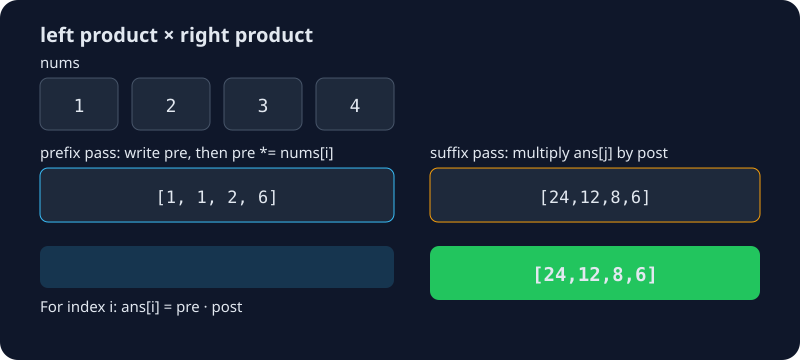

# 6. Product of Array Except Self

## 1. Problem Statement
For each array index, return the product of every value except the one at that index; `[1,2,3,4]` gives `[24,12,8,6]`. Tests show zeros, negatives, and one element; products are stored as `int`, and an empty array is not demonstrated.

## 2. Pattern / Category
Prefix and suffix products.

## 3. Intuition
At each index, multiply the product to its left by the product to its right.



## 4. Brute Force Approach
For each index, multiply every other element: O(n²) time and O(n) output space; this baseline is not used by the source.

## 5. Optimal Approach (My Solution)
`ans` starts filled with 1. The first loop writes the running left product `pre` into `ans[i]`, then multiplies `pre` by `nums[i]`. The reverse loop multiplies each answer by the running right product `post`, then updates `post`.

Dry run for source case `[1,2,3,4]`: first pass makes `ans=[1,1,2,6]`; reverse pass multiplies by suffixes `1,4,12,24` as it moves left, yielding `[24,12,8,6]`.



## 6. Code
```cpp
class Solution {
public:
    vector<int> productExceptSelf(vector<int>& nums) {
        int pre = 1, post = 1;
        vector<int> ans(nums.size(),1);

        for(int i=0; i<nums.size();i++){
          ans[i]=pre;
          pre*=nums[i];
        }
        for(int j=nums.size()-1; j>=0; j--){
          ans[j]*=post;
          post*=nums[j];
        }
        return ans;
    }
};
```

## 7. Complexity Analysis
O(n) time. `ans` uses O(n) output space; auxiliary state beyond the result is O(1).

## 8. Edge Cases
- A zero naturally makes products for other indices zero; multiple zeros produce all zeros.
- A one-element input returns `[1]`.
- The source test cases do not include an empty array; its reverse-loop initializer is `nums.size()-1`.

## 9. Common Mistakes / Pitfalls
- Dividing the total product fails when the array contains zero.
- Updating the running product before writing the current prefix/suffix skips the needed boundary value.

## 10. Key Takeaways
Two directional passes compute each product without division or separate prefix/suffix arrays.

## 11. Related Problems
- Trapping Rain Water
- Prefix Sum
- Product of Array Except Self with division constraints

## 12. 30-Second Interview Explanation
I initialize the output with ones. A left-to-right pass stores the product before each index using `pre`; a right-to-left pass multiplies in the product after each index using `post`. On `[1,2,3,4]`, the prefix pass yields `[1,1,2,6]`, and the suffix pass finishes `[24,12,8,6]`, all in linear time.
