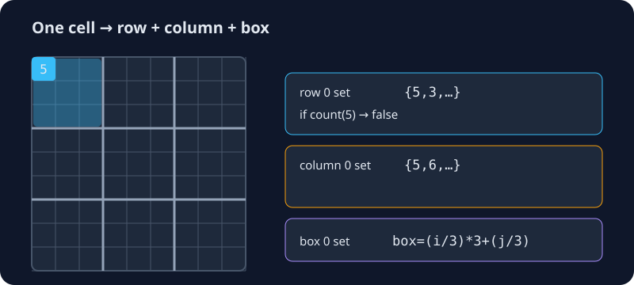

# 7. Valid Sudoku

## 1. Problem Statement
Determine whether the filled cells of a 9×9 Sudoku board repeat a digit in any row, column, or 3×3 box; `'.'` marks an empty cell. The standard sample board is valid, while the source's duplicate-first-row board is invalid. The code assumes nine rows/columns and digit/dot symbols.

## 2. Pattern / Category
Hash sets and 3×3 region indexing.

## 3. Intuition
As each nonempty cell is visited, remember its symbol in the three regions it belongs to; a repeated symbol invalidates the board.



## 4. Brute Force Approach
For every filled cell, scan the remainder of its row, column, and box for duplicates. This straightforward baseline is O(81²) time for a fixed 9×9 board and O(1) extra space; it is not the source implementation.

## 5. Optimal Approach (My Solution)
The source creates nine sets each for `rows`, `cols`, and `boxes`. It scans `i,j`; skips `'.'`; checks then inserts `val` in `rows[i]` and `cols[j]`. `boxNumber=(i/3)*3+(j/3)` selects the 3×3 set, which is checked and updated last.

Dry run from the source valid example: at `(0,0)`, `'5'` is inserted into row 0, column 0, and box 0. In the invalid first-row test, a repeated `'3'` reaches `rows[0].count(val)`, so the method returns false.



## 6. Code
```cpp
class Solution {
public:
    bool isValidSudoku(vector<vector<char>>& board) {
        const int N = board.size();
        vector<unordered_set<char>> rows(9);
        vector<unordered_set<char>> cols(9);
        vector<unordered_set<char>> boxes(9);

        for(int i=0; i<N; i++){
          for(int j=0; j<N; j++){
            char val = board[i][j];
            if(val=='.'){
              continue;
            }
            if(rows[i].count(val)){
              return false;
            }
            rows[i].insert(val);
            if(cols[j].count(val)){
              return false;
            }
            cols[j].insert(val);
            int boxNumber = (i/3) *3+(j/3);
            if(boxes[boxNumber].count(val)){
              return false;
            }
            boxes[boxNumber].insert(val);
          }
        }
        return true;
    }
};
```

## 7. Complexity Analysis
For an N×N input, O(N²) average time using hash-set operations and O(1) space for the fixed 9×9 sets. The implementation is intended for a 9×9 board; its region storage is fixed at nine sets per category.

## 8. Edge Cases
- Empty cells are ignored.
- A duplicate in a row, column, or box returns false immediately.
- The code expects the standard 9×9 layout and digit/dot symbols.

## 9. Common Mistakes / Pitfalls
- Treating the board as invalid merely because it is incomplete.
- Using `i/3 + j/3` instead of the flattened box formula.
- Checking only rows while missing column or box duplicates.

## 10. Key Takeaways
One pass can check all three Sudoku constraints by updating three region sets per filled cell.

## 11. Related Problems
- Valid Anagram
- Set Matrix Zeroes
- Sudoku Solver

## 12. 30-Second Interview Explanation
I scan every cell and ignore dots. For each digit, I check whether it already exists in that row, column, or 3×3 box; the box index is `(i/3)*3+(j/3)`. Any duplicate returns false, otherwise I insert the digit in all three sets. The source's duplicate-row test stops at the row check.
