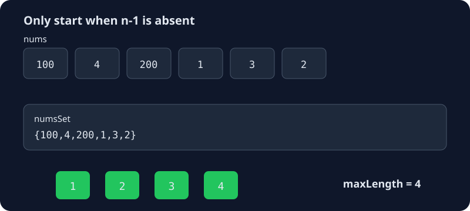

# 8. Longest Consecutive Sequence

## 1. Problem Statement
Return the length of the longest run of consecutive integer values in an unsorted array, regardless of adjacency; `[100,4,200,1,3,2]` gives 4. Source tests include duplicates, negatives, and empty input; values are `int`.

## 2. Pattern / Category
Hash set; expand only from sequence starts.

## 3. Intuition
If `n-1` exists, `n` is not a sequence start. Count forward only from values with no predecessor.



## 4. Brute Force Approach
Sort a copy, skip duplicate neighbors, and count consecutive runs: O(n log n) time and O(n) extra space for the copy. This is a baseline, not what the source does.

## 5. Optimal Approach (My Solution)
`numsSet` stores each distinct number. The second loop resets `consecutiveSequenceLength`; it skips `n` if `n-1` is in the set. Otherwise it counts `n`, increments `n` while `n+1` is present, and updates `maxLength`.

Dry run from `[100,4,200,1,3,2]`: the set includes `1,2,3,4,100,200`; values with predecessors are skipped, and starting at `1` finds `2,3,4`, so `maxLength` becomes 4.



## 6. Code
```cpp
class Solution
{
public:
  int longestConsecutive(vector<int> &nums)
  {
    unordered_set<int> numsSet;
    for (int n : nums)
    {
      if (!numsSet.count(n))
      {
        numsSet.insert(n);
      }
    }
    int consecutiveSequenceLength = 0;
    int maxLength = 0;
    for (int n : nums)
    {
      consecutiveSequenceLength = 0;
      if (numsSet.count(n - 1))
      {
        continue;
      }
      consecutiveSequenceLength += 1;
      while (numsSet.count(n + 1))
      {
        consecutiveSequenceLength += 1;
        n+=1;
      }
      maxLength = maxLength > consecutiveSequenceLength ? maxLength : consecutiveSequenceLength;
    }
    return maxLength;
  }
};
```

## 7. Complexity Analysis
Set construction is O(n) average, but the expansion loop scans the original `nums`, so duplicate copies of a sequence start can repeat the same walk. Time is O(nu) worst case (O(n²)), where `u` is the distinct count; with no repeated starts it is O(n). Space is O(u).

## 8. Edge Cases
- Empty input returns 0; one value returns 1.
- Duplicate values do not extend a sequence.
- Negative consecutive values work the same way.

## 9. Common Mistakes / Pitfalls
- Expanding from every value causes repeated work.
- This source iterates over `nums`, not `numsSet`; repeated copies of a start can expand the same run repeatedly.
- Sorting is not part of this solution.
- `n-1` and `n+1` use `int`; extreme integer endpoints can overflow outside typical problem constraints.

## 10. Key Takeaways
Use a hash set for membership and start expansions only where the predecessor is absent.

## 11. Related Problems
- Contains Duplicate
- Longest Increasing Subsequence
- Array Nesting

## 12. 30-Second Interview Explanation
I put the input values in `numsSet`, then scan the original array. A value with a predecessor cannot start a longer run, so I skip it. For each start, I count consecutive successors and maximize `maxLength`. In the source example, only `1` starts the `1,2,3,4` run, giving 4.
