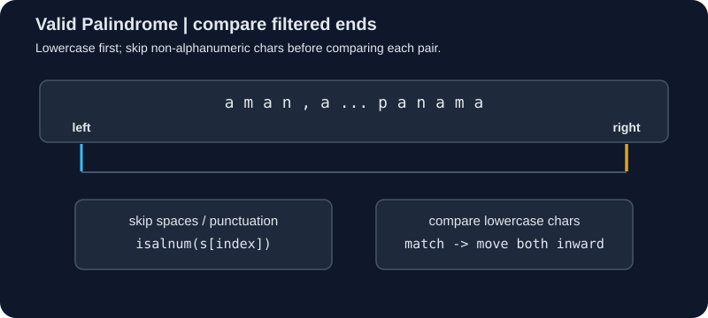

# 9. Valid Palindrome

## 1. Problem Statement
Check whether a string reads the same forward and backward when case is ignored and non-alphanumeric characters are ignored; `"A man, a plan, a canal: Panama"` is true. Source tests also include punctuation-only, empty, and whitespace strings; code uses `char` classification.

## 2. Pattern / Category
Two pointers and character filtering.

## 3. Intuition
Move inward from both ends, skipping punctuation, and compare the next alphanumeric characters.



## 4. Brute Force Approach
Build a normalized string containing only lowercase alphanumeric characters, then compare it with its reverse. This baseline is O(n) time and O(n) extra space; it is not the source method.

## 5. Optimal Approach (My Solution)
The code lowercases each character in `s`, initializes `left=0` and `right=s.length()-1`, skips non-alphanumeric characters at both ends, compares the remaining characters, then moves both pointers inward.

Dry run from `"A man, a plan, a canal: Panama"`: after lowercasing and skipping spaces/punctuation, the outer comparison is `a` vs `a`, then `m` vs `m`, and so on; matching pairs return true.



## 6. Code
```cpp
class Solution
{
public:
  bool isPalindrome(string s)
  {
    for (auto &x : s)
    {
      x = tolower(x);
    }
    int left = 0, right = s.length() - 1;
    while (left < right)
    {
      while (!isalnum(s[left]))
      {
        left++;
      }
      while (!isalnum(s[right]))
      {
        right--;
      }
      if (s[left] != s[right])
      {
        return false;
      }
      left++, right--;
    }
    return true;
  }
};
```

## 7. Complexity Analysis
O(n) time and O(1) auxiliary space (the input string is passed by value and modified in place).

## 8. Edge Cases
- Empty and one-character inputs pass the outer `left < right` test.
- Important source caveat: the inner skip loops have no `left < right`/bounds checks. For an all-punctuation string such as the source test `".,!@#"`, the pointers can cross and then index outside the string; behavior is undefined. Thus that test is not safely handled by this implementation.
- `tolower`/`isalnum` are called on `char`; non-ASCII or negative signed-char values need care.

## 9. Common Mistakes / Pitfalls
- Comparing punctuation instead of skipping it.
- Assuming every test string is safe because the outer loop checks the pointers; that guard is not repeated inside the skip loops.
- Forgetting case normalization.

## 10. Key Takeaways
Two pointers avoid constructing a filtered copy, but each skip loop must remain in bounds for robust handling.

## 11. Related Problems
- Valid Palindrome II
- Two Sum II
- Reverse String

## 12. 30-Second Interview Explanation
The intended approach lowercases the string, skips non-alphanumeric characters at both ends, compares the next pair, and moves inward. The source does this in constant auxiliary space. Its inner skip loops lack bounds checks, however, so the punctuation-only test included in `main` can access outside the string; this implementation caveat should be fixed before claiming all such inputs work.
